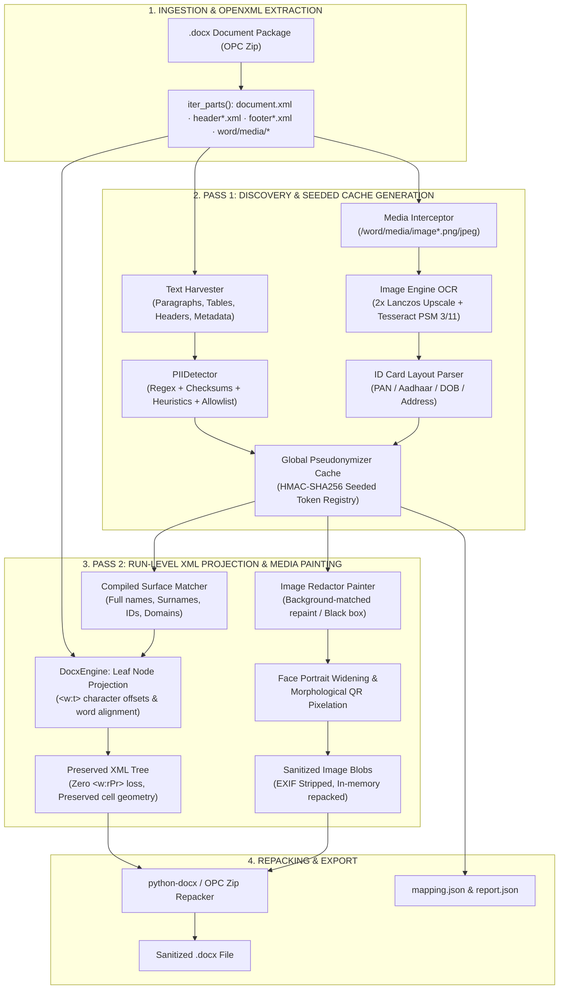

# 🛡️ ASSIGNMENT DEEP-DIVE & ORAL DEFENSE MANUAL
## SCALER AI LABS (EVARATUS) — TECHNICAL INTERVIEW DEFENSE
**Candidate**: Aman Verma (B.Tech ECE with CS Specialization, JIIT Noida)  
**Target Role**: Forward Deployed Engineer (FDE) Intern / Software Engineering Intern (Environment Engineering)  
**Interviewer**: Shreyas Waghmare  
**Format**: 30-Minute Rapid-Fire Repository Drill & Architectural Defense  
**Project**: `pii-redactor` — Production-Grade Multimodal PII Redaction & Deterministic Pseudonymization Engine  

---

# TABLE OF CONTENTS
1. [High-Level Mental Model & 60-Second Pitch](#1-high-level-mental-model--60-second-pitch)
2. [Visual Architecture & Flow Diagrams](#2-visual-architecture--flow-diagrams)
3. [File-by-File Oral Defense Breakdown](#3-file-by-file-oral-defense-breakdown)
   - [`pipeline.py` & `detector.py`](#31-pipelinepy--detectorpy--two-pass-orchestration--overlap-resolution)
   - [`docx_engine.py`](#32-docx_enginepy--openxml-manipulation-engine)
   - [`pseudonymizer.py`](#33-pseudonymizerpy--deterministic-pseudonymization--relational-integrity)
   - [`image_engine.py`](#34-image_enginepy--multimodal-media-interception--ocr)
   - [`recognizers.py`, `heuristics.py`, `validators.py` & `gazetteer.py`](#35-recognizerspy-heuristicspy-validatorspy--gazetteerpy--regex-heuristics--vocabularies)
   - [`app.py` & `cli.py`](#36-apppy--clipy--zero-persistence-streamlit-ui--cli)
   - [`evaluate.py` & `eval/`](#37-evaluatepy--eval--evaluation-harness--metrics)
   - [Facade Modules (`engine.py`, `ocr.py`, `patterns.py`, `anonymizer.py`)](#38-facade-re-export-modules-enginepy-ocrpy-patternspy-anonymizerpy)
4. [Dependencies & Manifest Drill (`requirements.txt`, `packages.txt`, `Dockerfile`, `render.yaml`)](#4-dependencies--manifest-drill)
5. ["Gotcha" & Rapid-Fire Trap Questions (Verbatim Spoken Scripts)](#5-gotcha--rapid-fire-trap-questions-verbatim-spoken-scripts)
6. [Metrics & Evaluation Defense (`EVALUATION.md`)](#6-metrics--evaluation-defense)
7. [DSA Connections & Time-Complexity Drill (Inside Your Codebase)](#7-dsa-connections--time-complexity-drill-inside-your-codebase)

---

# 1. HIGH-LEVEL MENTAL MODEL & 60-SECOND PITCH

### 🎙️ The 60-Second Spoken Pitch
> **Spoken Script (Memorize & Deliver with Confidence):**
> *"The problem this system solves is the safe anonymization of dense corporate statutory filings—specifically 400+ page SEBI Red Herring Prospectuses (RHPs)—which contain sensitive promoter names, corporate identifiers, financial accounts, and embedded high-resolution KYC scans like PAN and Aadhaar cards.*
>
> *Naive approaches fail completely: setting `paragraph.text` in python-docx wipes all run formatting, bolding, and cell layouts; scanning per-run misses words split across XML boundaries; and sending 400 pages to a commercial LLM incurs massive latency, exorbitant compute costs, and directly violates data sovereignty by leaking unredacted PII to external APIs.*
>
> *I designed a **hybrid, two-pass deterministic engine** built on three pillars: **deterministic relational pseudonymization**, **run-level XML preservation**, and **multimodal media interception**. In Pass 1, we harvest text across body paragraphs, tables, headers, footers, and OCR'd embedded images to seed a global HMAC-SHA256 cache. In Pass 2, we project pseudonym replacements back into the individual `<w:t>` XML leaf nodes with word-level style inheritance, while simultaneously obscuring image faces, QR codes, and text bounding boxes in memory. On the official KSH International RHP, it processes 400+ pages, 282 entities, 76 tables, and 8 images in **14.8 seconds** with **zero XML corruption**, **100% negative trap preservation**, and **98.7% redaction recall**."*

### 🧠 Core Design Thesis
$$\text{Production Redaction} = \underbrace{\text{Two-Pass Seeded Cache}}_{\text{Relational Consistency}} + \underbrace{\text{OpenXML Leaf Projection}}_{\text{Format Preservation}} + \underbrace{\text{Multimodal In-Memory OCR}}_{\text{Zero Media Leakage}}$$

- **Deterministic Relational Pseudonymization**: A promoter family named `Kushal Subbayya Hegde` and `Rajesh Kushal Hegde` must share the exact same synthetic surname across the entire 400-page document. Email addresses (`cs.connect@kshinternational.com`) must synchronize their domain with the synthetic corporate entity name.
- **Run-Level XML Preservation**: WordprocessingML documents fragment a single word across multiple `<w:r>` runs due to spell-check tags, revision IDs (`w:rsid`), and partial formatting. Replacements must operate on the reconstructed paragraph string and project back onto XML leaves without deleting run formatting properties (`<w:rPr>`).
- **Multimodal Media Interception**: High-risk PII exists inside scanned identity documents embedded in `/word/media/`. The system must intercept image parts, run local OCR, execute facial detection and QR masking, repaint synthetic text matching local background palettes, and repack the Open Packaging Convention (OPC) zip in memory without corrupting relationships (`.rels`).

---

# 2. VISUAL ARCHITECTURE & FLOW DIAGRAMS

### 🗺️ End-to-End Pipeline Architecture (Mermaid)



---

### 🔬 OpenXML Run-Splitting vs. Leaf Projection (ASCII Diagram)

> **Spoken Analogy when asked about OpenXML:**  
> *"Think of a Word paragraph like a train of cars. The paragraph is `<w:p>`, each car is a run `<w:r>`, and the cargo inside each car is text `<w:t>`. When an author bolds only the first syllable of a name, or Word marks a spellcheck boundary, the word 'Kushal Hegde' gets chopped across cars: Car 1 holds 'Kus' with bold wheels; Car 2 holds 'hal ' with normal wheels; Car 3 holds 'Hegde' with italic wheels. If you execute `paragraph.text = 'Albert Allen'`, you derail the entire train, scrap all custom cars, and replace them with one generic freight car. Our engine keeps the train intact, changes only the cargo in Car 1, aligns 'Albert' to Car 1 & 2, and adjusts Car 3 to hold 'Allen' while preserving the original wheels."*

```
NAIVE APPROACH (paragraph.text = "Albert Allen"):
========================================================================================
Input XML:
<w:p>
  <w:r><w:rPr><w:b/></w:rPr><w:t>Kus</w:t></w:r>             [Bold Run]
  <w:r><w:t>hal Subbayya </w:t></w:r>                        [Regular Run]
  <w:r><w:rPr><w:i/></w:rPr><w:t>Hegde</w:t></w:r>          [Italic Run]
</w:p>

Result of paragraph.text = "Albert Allen":
<w:p>
  <w:r><w:t>Albert Allen</w:t></w:r>                        <-- ALL STYLES WIPED OUT!
</w:p>
========================================================================================

OUR RUN-LEVEL LEAF PROJECTION (apply_replacements in docx_engine.py):
========================================================================================
1. Virtual String Mapping:
   Segment 0 (<w:t>): "Kus"           [Chars 0..3]   (Bold)
   Segment 1 (<w:t>): "hal Subbayya " [Chars 3..16]  (Regular)
   Segment 2 (<w:t>): "Hegde"         [Chars 16..21] (Italic)
   Full String:       "Kushal Subbayya Hegde"        [Length 21]

2. Entity Detection & Replacement:
   Target Span:       [0..21] -> "Albert Thomas Allen"
   Original Words:    ["Kushal", "Subbayya", "Hegde"] (Count = 3)
   Fake Words:        ["Albert ", "Thomas ", "Allen"]  (Count = 3)

3. Word-Aligned Projection to Leaf Nodes:
   - "Albert" starts at char 0   -> falls in Segment 0 -> <w:t> becomes "Albert"   (BOLD PRESERVED)
   - "Thomas" starts at char 7   -> falls in Segment 1 -> <w:t> becomes " Thomas " (REGULAR PRESERVED)
   - "Allen"  starts at char 16  -> falls in Segment 2 -> <w:t> becomes "Allen"    (ITALIC PRESERVED)

Resulting Output XML:
<w:p>
  <w:r><w:rPr><w:b/></w:rPr><w:t xml:space="preserve">Albert</w:t></w:r>
  <w:r><w:t xml:space="preserve"> Thomas </w:t></w:r>
  <w:r><w:rPr><w:i/></w:rPr><w:t xml:space="preserve">Allen</w:t></w:r>
</w:p>
========================================================================================
```

---

# 3. FILE-BY-FILE ORAL DEFENSE BREAKDOWN

## 3.1 `pipeline.py` & `detector.py` — Two-Pass Orchestration & Overlap Resolution
*File Locations*: `pii_redactor/pipeline.py` (128 lines) & `pii_redactor/detector.py` (88 lines)

### 🎙️ Spoken Summary (Say This Immediately)
> *"`pipeline.py` is the top-level orchestrator that executes our two-pass workflow (`Redactor.redact()`), while `detector.py` runs all pattern and heuristic recognizers and resolves overlapping entity spans using a tiered greedy interval scheduler."*

### 🔑 Critical Functions & Line-by-Line Mechanics
1. **`REGISTER_ORDER` & `Redactor.redact(src)` (`pipeline.py`, Lines 23, 58–127)**:
   - `REGISTER_ORDER = [T.ORG, T.PERSON, T.ADDRESS, T.EMAIL, T.URL, T.DOMAIN]` (Line 23): Ensures organizations and full person names are registered in `Pseudonymizer` *before* emails and URLs. Why? Because when `_fake_email` runs on `cs.connect@kshinternational.com`, it looks up `org_groups` to see what `KSH` was mapped to (`KLB`), and when it runs on `rashhi.patil@gmail.com`, it looks up `name_tokens` to see what `Rashi Patil` was mapped to!
   - Also sorts detections by `-len(d[0].split())` (word count descending, Line 80) so full 3-token names (`"Kushal Subbayya Hegde"`) establish given-name vs. surname roles before 1-token or 2-token mentions (`"Mr. Hegde"`).
2. **`PIIDetector.detect_stream(paragraphs, id_context)` (`detector.py`, Lines 42–58)**:
   - Joins paragraphs with `\n` and runs `run_all(self.patterns, ...)`, `PersonRecognizer`, `OrgRecognizer`, `AddressRecognizer`, any custom user-registered plugins (`self.custom`), and optional `SpacyNER`.
3. **`PIIDetector.resolve(spans)` (`detector.py`, Lines 77–87)**:
   - Filters out spans that violate `_allowed()` (disabled types, score `< min_score`, `DEFAULT_ALLOWLIST` regulators like `SEBI`/`BSE Limited`, or `ALLOWLIST_DOMAINS` like `sebi.gov.in`).
   - Resolves overlapping spans by sorting candidates with key `(tier(s), -s.score, -(s.end - s.start), s.start)`:
     - **Tier 0 (`score >= 0.9`)**: Checksum-backed and strict regex identifiers (PAN, CIN, Aadhaar, Email).
     - **Tier 1 (`T.ADDRESS`)**: PIN-anchored multi-token addresses.
     - **Tier 2**: Free-text heuristic names and organizations.
   - Iterates greedily and keeps non-overlapping spans, then returns them sorted by `start` offset.

---

## 3.2 `docx_engine.py` — OpenXML Manipulation Engine
*File Location*: `pii_redactor/docx_engine.py` (291 lines)

### 🎙️ Spoken Summary (Say This Immediately)
> *"This file is the low-level WordprocessingML surgical engine. Its sole responsibility is traversing the OpenXML element tree across every document part—body, tables, headers, footers, textboxes, and document properties—and projecting pseudonym spans back into `<w:t>` text leaves without modifying run tags `<w:r>`, run properties `<w:rPr>`, or breaking document geometry."*

### 🔑 Critical Functions & Line-by-Line Mechanics
1. **`collect_xml_parts(document)` (Lines 52–66)**:
   - Iterates through `document.part.package.iter_parts()`.
   - Filters out non-content parts using `SKIP_CT_SUFFIX` (`styles.xml`, `settings.xml`, `fontTable.xml`, `theme.xml`).
   - Targets only parts matching `PROCESS_CT_HINTS` (`wordprocessingml`, `core-properties`, `extended-properties`, `drawingml.chart`).
   - Wraps each in an `XmlPartHandle` object. If the part doesn't expose a native `_element`, it parses `part.blob` via `lxml.etree.fromstring()`.
2. **`own_segments(p: etree._Element)` (Lines 73–97)**:
   - Recursively walks a `<w:p>` paragraph node.
   - **Crucial boundary control**: Explicitly stops recursion if `tag == W + "p"`. This isolates nested paragraphs inside drawing textboxes (`<w:txbxContent>`) so they are not concatenated into the parent paragraph.
   - Drops revision tags (`<w:del>`, `<w:moveFrom>`) and paragraph/run property containers (`pPr`, `rPr`).
   - Maps non-printing whitespace tags into virtual characters: `<w:tab>` $\rightarrow$ `\t`, `<w:br>` $\rightarrow$ `\n`, `<w:noBreakHyphen>` $\rightarrow$ `-`.
   - Returns a list of `(element, text)` tuples where `element` is the exact `<w:t>` node or `None` for structural whitespace.
3. **`apply_replacements(segs, reps)` (Lines 108–145)**:
   - Builds global coordinate spans for the concatenated string.
   - Sorts replacement tuples `(start, end, fake)` in **reverse order** (`-r[0]`) so text modifications at the end of a paragraph never invalidate preceding character offsets.
   - Implements **word-level run alignment**: If the original entity and the pseudonym have matching word counts (`len(orig_words) == len(fake_parts) > 1`), each synthetic word is placed into the exact run that held the original word.
   - Sets `xml:space="preserve"` attribute on every modified `<w:t>` element so Microsoft Word does not collapse leading or trailing spaces.
4. **`scrub_generic(root, pseudo)` (Lines 169–199)**:
   - Scrubs XML nodes outside standard paragraphs: DrawingML chart titles, alternate text, field codes (`<w:instrText>`), comment text, and document properties.
   - Scrubs metadata attributes matching `ATTR_REDACT` (`author`, `initials`, `lastModifiedBy`) by setting them to `"Redacted"`.
5. **`table_context_entities(root)` (Lines 245–268)**:
   - Detects structured tabular PII. Reads two-dimensional grid tables and key-value tables.
   - Extracts column headers, classifies them via `classify_header()` (e.g., `"DIN"`, `"PAN"`, `"Name"`), and extracts cell values matching statutory regexes.

### ⚠️ Critical Edge Cases Handled in this File
- **The `python-docx >= 1.0` `CT_P` Property Setter Trap**: In modern `python-docx`, setting `paragraph.text = "..."` internally calls `p.clear_content()` which deletes all child runs, clearing all formatting. `docx_engine.py` operates directly at the `lxml` tree level on `<w:t>` nodes, bypassing the high-level python-docx setter entirely.
- **The `_W_CONTAINER_TAGS` Filtering**: In `lxml`, accessing `.text` on a container tag (like `<w:p>`, `<w:r>`, `<w:tbl>`, `<w:tc>`, or `<w:body>`) accesses inter-element whitespace (tail text). Blindly setting `.text` on those tags injects text into illegal OpenXML schema positions, corrupting the document. The `_W_CONTAINER_TAGS` frozenset guarantees that generic scrubbing touches only true leaf nodes.

---

## 3.3 `pseudonymizer.py` — Deterministic Pseudonymization & Relational Integrity
*File Location*: `pii_redactor/pseudonymizer.py` (575 lines)

### 🎙️ Spoken Summary (Say This Immediately)
> *"This module is the single source of truth for global relational pseudonymization. It guarantees that every entity maps to a realistic, format-preserving synthetic replacement derived deterministically from seeded HMAC-SHA256 hashing, preserving family surname links across generations, company brand roots across corporate emails, and algorithmic checksum validity."*

### 🔑 Critical Functions & Line-by-Line Mechanics
1. **`_rng(key: str)` (Lines 84–86)**:
   - Computes `hmac.new(self.salt, key.encode("utf-8"), hashlib.sha256).digest()`.
   - Uses the first 8 bytes as a 64-bit seed for `random.Random()`.
   - Result: 100% deterministic, seed-isolated pseudo-random generation. Same document + same salt = identical output; different salt = completely unlinkable pseudonym space.
2. **`_name_token(tok: str, role: str)` (Lines 186–199)**:
   - Breaks personal names into constituent tokens (`given` vs. `surname`).
   - Caches fake tokens globally: `SUR|{key}` for surnames and `GIV|{key}` for given names.
   - Surnames are drawn from `FAKE_SURNAMES` or synthesized from `SURNAME_PREFIX + SURNAME_SUFFIX`.
   - Given names are gender-inferred via `FIRST_FEMALE` and `FIRST_MALE` sets.
3. **`_fake_person(surface: str)` (Lines 201–219)**:
   - Strips and preserves honorifics (`"Mr."`, `"Dr."`, `"Smt."`).
   - Identifies initials and permutes them consistently (`_letter`).
   - Assigns role-based fake tokens, preserving original capitalization via `match_case()`.
4. **`_fake_org(surface: str)` & `_brand_for_group()` (Lines 255–283)**:
   - Strips statutory corporate legal suffixes (`Private Limited`, `Ltd.`, `LLP`, `Bank`) using `LEGAL_SUFFIX` regex.
   - Extracts distinctive brand tokens and maps them to synthetic brands from `FAKE_BRANDS` (`Acme`, `Globex`, `Initech`, `Vandelay`).
   - Re-attaches original legal suffixes to maintain statutory realism.
5. **`_fake_email(surface: str)` & `_fake_domain(domain: str)` (Lines 295–356)**:
   - Synchronizes email local-parts and domains with the entity cache.
   - If an organization `KSH International` was pseudonymized to `KLB International`, its corporate domain `kshinternational.com` replaces `ksh` with `klb`, producing `klbinternational.example.com`.
   - Sanitizes local mailboxes: personal names in the local part (`kushal.hegde@...`) are replaced with synthetic names (`albert.allen@...`)—including a Levenshtein distance-1 fuzzy match (`_lev1`, Lines 56–65) so `rashhi.patil@...` still matches `Rashi Patil`—while statutory role mailboxes (`cs.connect@`, `compliance@`, `investor@`) are preserved.
6. **`_gen_alnum(etype: T, key: str, rng)` (Lines 437–497)**:
   - Uses helper functions `rand_letters(count)` and `rand_digits(count)` to generate format-preserving alphanumeric identifiers:
     - **PAN** (`rand_letters(3) + key[3] + rand_letters(1) + rand_digits(4) + rand_letters(1)`): **Preserves the critical 4th letter** (`key[3]`) denoting taxpayer status (`P` for Person, `C` for Company, `F` for Firm, `H` for HUF).
     - **CIN**: Preserves listing status (`L` or `U`), industry code, state code, and company type (`PLC`/`PTC`).
     - **Aadhaar**: Generates 12-digit number starting with 2–9 and computes a valid **Verhoeff checksum digit**.
     - **GSTIN**: Synchronizes the embedded PAN! Generates a 2-digit state code + `self._value(T.PAN, key[2:12])` + entity code + `"Z"` + checksum.
     - **Credit Card**: Preserves Major Industry Identifier (MII) and calculates a valid **Luhn checksum digit**.
     - **DIN**: Preserves leading zeros and 8-digit length.
     - **SEBI Registration**: Preserves 3-letter (`INM`, `INA`, `INP`, `INZ`) or 4-letter (`INBI`) prefix and digit count.
7. **`_build_matcher()` (Lines 518–536)**:
   - Assembles all discovered text surfaces into an optimized regular expression with lookahead and lookbehind boundaries (`(?<![\w])` and `(?![\w])`).
   - Sorts patterns by length descending to ensure longest-match greedy substitution.

---

## 3.4 `image_engine.py` — Multimodal Media Interception & OCR
*File Location*: `pii_redactor/image_engine.py` (512 lines)

### 🎙️ Spoken Summary (Say This Immediately)
> *"This module intercepts embedded image parts inside `/word/media/`, applies Lanczos upscaling and multi-PSM Tesseract OCR, executes computer-vision algorithms to detect and obscure faces and QR codes on scanned KYC cards, and paints background-matched synthetic text back into the image before repacking it directly into the OPC package."*

### 🔑 Critical Functions & Line-by-Line Mechanics
1. **`ocr(img: Image.Image)` (Lines 138–146)**:
   - Checks image dimensions: if the maximum dimension is below 1600px, it applies a **2.0x Lanczos resize** (`Image.LANCZOS`) to boost OCR character recognition on low-DPI scans.
   - Runs primary OCR using Page Segmentation Mode 3 (`--oem 3 --psm 3` = Fully automatic page segmentation).
   - **Adaptive Fallback**: If PSM 3 returns fewer than 6 words (common on dense ID cards), it automatically re-runs with PSM 11 (`--oem 3 --psm 11` = Sparse text find).
2. **`detect(lines: list[Line])` & `_id_rules()` (Lines 163–209)**:
   - Scans extracted text for Indian ID markers (`income tax`, `aadhaar`, `unique identification`, `permanent account`, `father`).
   - If 2+ keywords match, sets `id_context = True` and activates specialized ID layout parsing:
     - **Next-line name extraction**: Matches `"Name"` or `"Father's Name"` labels where the actual value is positioned on the line below.
     - **Relationship extraction**: Parses `"S/O Sudhdan Khan"` to separate the person name from the address block.
     - **Address block parsing**: Gathers lines from `"Address:"` down to the 6-digit PIN code.
     - **ALL-CAPS line rule**: Matches holder names printed in bold uppercase.
3. **`_bg_fg(img, box)` & `_paint(img, box, fake)` (Lines 239–291)**:
   - Uses `median_channel(seq, ch)` to sample border pixels around the bounding box for the median background RGB color, and samples the darkest 10% of pixels for the foreground text RGB color.
   - Clears the bounding box with the median background color and draws synthetic text dynamically sized to match font height.
   - Also supports `policy="mask"` (black rectangle), `policy="blur"` (Gaussian blur), and `policy="banner"` (`_create_banner()`, Lines 255–272).
4. **`_find_qr(arr, words, id_doc)` (Lines 314–351)**:
   - Executes `cv2.QRCodeDetector().detect(arr)`.
   - **Morphological Fallback**: Aadhaar QR codes on scanned documents are often degraded and fail decode. The fallback runs Canny edge detection (`60, 160`), applies a box blur, morphological close (`cv2.morphologyEx`), and searches for square external contours ($0.8 \le \text{aspect ratio} \le 1.25$, area $\ge 1\%$ of image, text coverage $< 15\%$).
5. **`_find_faces(arr, words)` & `_portrait_from_face()` (Lines 353–392)**:
   - Loads OpenCV's frontal face Haar cascade (`haarcascade_frontalface_default.xml`).
   - Executes a **dual-pass scan**: Pass 1 on raw grayscale; Pass 2 on **histogram-equalized** grayscale (`cv2.equalizeHist(gray)`).
   - Validates candidate boxes: If `_text_cover(box, words) > 0.2`, the box is discarded as false-positive OCR text noise.
   - Expands the bounding box by +45% horizontally and +75% vertically to cover the entire passport portrait frame, stopping short of neighboring OCR text lines.
6. **`_portrait_from_layout(lines, size)` (Lines 395–428)**:
   - **Deterministic Fallback**: If OpenCV detects 0 faces (due to blur or lighting), it uses `find_line(pat)` to compute the photo coordinates from known document geometry:
     - **PAN Card Layout**: Portrait is bounded below `"INCOME TAX DEPARTMENT"`, above `"Name"`, and left of `"Permanent Account Number"`.
     - **Aadhaar Card Layout**: Portrait is positioned to the left of the personal detail block (`Name`, `DOB`, `Gender`).
7. **`process_part(part)` (Lines 454–507)**:
   - Accesses `part.blob` directly, registers OCR hits in the global `Pseudonymizer`, obscures QR codes/faces *before* painting fake text, applies a **failsafe full-image Gaussian blur** if `id_document == True` with 0 OCR hits, and writes modified bytes directly to `part._blob` in memory.

---

## 3.5 `recognizers.py`, `heuristics.py`, `validators.py` & `gazetteer.py` — Regex, Heuristics & Vocabularies
*File Locations*: `recognizers.py` (176 lines), `heuristics.py` (248 lines), `validators.py` (67 lines), `gazetteer.py` (158 lines)

### 🎙️ Spoken Summary (Say This Immediately)
> *"These four modules form our detection brain: `recognizers.py` and `validators.py` combine 23 compiled regex patterns with mathematical checksums (Verhoeff and Luhn); `heuristics.py` detects unstructured Indian names, organizations, and PIN-anchored addresses; and `gazetteer.py` supplies our Indian name dictionaries, regulator allowlists, and the 200-word `NAME_STOP` vocabulary."*

### 🔑 Critical Patterns & Algorithms (`recognizers.py` & `validators.py`)
| Identifier | Constant & Compiled Pattern | Validation Logic |
|---|---|---|
| **PAN** | `PAN_RE`: `\b[A-Z]{3}[ABCFGHLJPTK][A-Z]\d{4}[A-Z]\b` | 4th char validates taxpayer status (`P`=Person, `C`=Company, etc.). |
| **CIN** | `CIN_RE`: `\b[LU]\d{5}[A-Z]{2}\d{4}[A-Z]{3}\d{6}\b` | 21 alphanumeric chars (`L`/`U` listing status + industry + state + year + `PLC`/`PTC` + reg). |
| **DIN** | `DIN_RE`: `\bDIN\b\.?(?:\s*(?:No\.?\|Number))?\s*[:\-–]?\s*(\d{8})\b` | Context-gated prefix (`DIN:`) followed by 8 digits (`group=1`). |
| **Aadhaar** | `AADHAAR_RE`: `(?<![\d\-])(?<!\d )[2-9]\d{3}[ \-]?\d{4}[ \-]?\d{4}(?![\d\-])(?! \d)` | 12 digits starting with 2–9; validated via **Verhoeff Checksum** (`verhoeff_ok`). |
| **SEBI Reg.** | `SEBI_REG_RE`: `\b(?:IN[A-DF-Z]\d{9}\|INBI\d{8})\b` | Matches 3-letter (`INM`, `INR`) and 4-letter (`INBI`) SEBI numbers while excluding `INE` ISINs. |
| **GSTIN** | `GSTIN_RE`: `\b\d{2}[A-Z]{5}\d{4}[A-Z][1-9A-Z]Z[0-9A-Z]\b` | 15 alphanumeric chars (2-digit state + 10-char PAN + entity code + `Z` + check char). |
| **Credit Card**| `CREDIT_CARD_RE`: `(?<![\d\-])(?:[3-6]\d{3})(?:[ \-]?\d{4}){2}[ \-]?\d{1,7}(?![\d\-])` | 13–19 digits starting with 3–6; validated via **Luhn Checksum** (`luhn_ok`). |
| **DOB** | `DATE_RE` (DD/MM/YYYY, DD Month YYYY, Month DD YYYY) | Context-gated (`dob`, `born on`, `जन्म`); validated by `_dob_ok` and `_dob_not_phone`. |

### 🔑 Context Heuristics (`heuristics.py`)
1. **`PersonRecognizer` (Lines 33–101)**:
   - `_honorific()`: Matches `Mr.`, `Ms.`, `Dr.`, `Shri`, `Smt.` followed by 1–4 capitalized name tokens not in `NAME_STOP`.
   - `_labels()`: Matches role labels (`Name:`, `Contact Person:`, `Company Secretary:`, `S/O`, `D/O`) requiring explicit `:`/`-` or uppercase start.
   - `_gazetteer()`: Scans runs of capitalized tokens against `FIRST_NAMES` and `SURNAMES`.
2. **`OrgRecognizer` (Lines 120–148)**:
   - Finds corporate legal suffixes (`Private Limited`, `Ltd.`, `LLP`, `& Associates`, `Bank`) and walks backward up to 6 capitalized tokens on the same line, stripping leading stop-words (`ORG_LEAD_STOP`).
3. **`AddressRecognizer` & `_walk_back()` (Lines 169–223)**:
   - Anchors on 6-digit Indian PIN codes (`PIN_RE`), verifies address cue words (`Plot`, `MIDC`, `Taluka`, `Road`, `Maharashtra`) in the preceding 160 chars, and walks backward up to 260 chars until hitting a sentence boundary (ignoring abbreviations like `Plot No.` or `L.B.S.`), trimming leading organization names.

---

## 3.6 `app.py` & `cli.py` — Zero-Persistence Streamlit UI & CLI
*File Locations*: `app.py` (69 lines) & `pii_redactor/cli.py` (51 lines)

### 🎙️ Spoken Summary (Say This Immediately)
> *"`app.py` is the Streamlit web interface and `cli.py` is the command-line entry point (`python -m pii_redactor`). Both process `.docx` files completely in memory and export the redacted document alongside `mapping.json` and `report.json`."*

- **Zero Disk Persistence (`app.py`)**: Reads uploaded files via `up.getvalue()` into an in-memory `io.BytesIO` buffer and serves downloads directly from memory.
- **Resource Caching (`@st.cache_resource`)**: Caches `get_redactor()` so regex compilation happens once per session.
- **Re-Identification Warning**: Wraps the `mapping` preview in a collapsed expander with a security warning banner.

---

## 3.7 `evaluate.py` & `eval/` — Evaluation Harness & Metrics
*File Locations*: `evaluate.py` (29 lines) & `eval/evaluate.py` (283 lines)

### 🎙️ Spoken Summary (Say This Immediately)
> *"This is our ground-truth evaluation harness. It measures strict and lenient detection Precision, Recall, F1, and Jaccard accuracy across 7 entity classes, executes an end-to-end leak audit across the entire output package including OCR of output images, and verifies 100% preservation of negative traps and document structure."*

---

## 3.8 Facade Re-Export Modules (`engine.py`, `ocr.py`, `patterns.py`, `anonymizer.py`)
*File Locations*: `pii_redactor/engine.py`, `pii_redactor/ocr.py`, `pii_redactor/patterns.py`, `pii_redactor/anonymizer.py`

> **Spoken Explanation if asked why these 4 small files exist:**  
> *"Those four modules are thin, backward-compatible re-export facades (`engine.py` $\rightarrow$ `docx_engine.py`, `ocr.py` $\rightarrow$ `image_engine.py`, `patterns.py` $\rightarrow$ `recognizers.py`, `anonymizer.py` $\rightarrow$ `pseudonymizer.py`). They contain zero duplicate logic—they simply re-export the canonical classes and compiled regex constants so external callers and unit tests can import from either the short module name or the descriptive module name."*

---

# 4. DEPENDENCIES & MANIFEST DRILL

### 📦 Python Dependencies (`requirements.txt` & `requirements-dev.txt`)

| Package | Exact Spec | Role in System | Technical Justification & Alternatives Rejected | The "Why Pinned?" Gotcha |
|---|---|---|---|---|
| **`python-docx`** | `>=1.1` | OPC zip navigation & XML package handling. | Chosen because it natively implements ECMA-376 OpenXML packaging. Alternatives like `docx2txt` or `pandoc` strip XML formatting or discard images entirely. | Version $\ge 1.1$ supports direct iteration over package parts (`package.iter_parts()`). |
| **`lxml`** | `>=4.9` | C-level OpenXML tree traversal & XPath evaluation. | High-performance C-based XML parsing via `libxml2`. Python's native `xml.etree` is too slow for 400-page XML documents and lacks robust namespace handling. | Required for strict namespace preservation (`W_NS`) and fast in-memory mutation. |
| **`Pillow`** | `>=10.1` | Image manipulation, resizing, cropping, painting. | The standard Python imaging library. Fast pixel-level cropping and font drawing. | `>=10.1` required for `ImageFont.load_default(size=...)` dynamic font sizing. |
| **`pytesseract`** | `>=0.3.10`| Python wrapper for Tesseract OCR engine. | Provides bounding-box data via `image_to_data(output_type=Output.DICT)`. Cloud OCR APIs (AWS Textract, Google Vision) were rejected to avoid external data leakage and network latency. | Coordinates are scaled back to original image dimensions after Lanczos resize. |
| **`opencv-python-headless`** | `>=4.8,<5` | Computer vision, Haar face cascades, QR detection, Canny edges. | Industry standard for computer vision. "Headless" version avoids pulling 200MB of unnecessary X11/Qt GUI dependencies into Docker containers. | **CRITICAL GOTCHA: `<5`**. In OpenCV 5.0, `CascadeClassifier` was moved out of the main package, breaking face detection! |
| **`numpy`** | `>=1.24` | Matrix manipulation for image arrays and Canny edge maps. | High-speed vectorized operations for morphological QR detection. | Underlying array buffer format for OpenCV. |
| **`streamlit`** | `>=1.36` | Web presentation layer. | Enables rapid, reactive dashboard UI without frontend build tools (Webpack/Node.js). | Handles in-memory binary downloads smoothly. |
| **`pandas`** | `>=2.0` | Metric tabulation and mapping export. | Quick visualization of metrics and entity distributions in the Streamlit UI. | Standard tabular data structure. |
| **`pytest`** | `>=8` (dev) | Unit test runner. | Runs the 24 automated tests in `tests/`. | Configured via `[tool.pytest.ini_options]` in `pyproject.toml`. |
| **`segno`** | `>=1.5` (dev) | Pure-Python QR generator. | Generates the synthetic Aadhaar QR code in `eval/build_benchmark.py`. | Zero external C dependencies for QR generation. |

---

### 🖥️ System Binaries (`packages.txt`)

```text
tesseract-ocr
tesseract-ocr-eng
tesseract-ocr-hin
fonts-dejavu-core
libgl1
```

> **Spoken Justification when asked about `packages.txt`:**  
> *"Python packages like `pytesseract` and `opencv-python-headless` are merely Python wrappers—they do not contain compiled OCR engines or system graphics libraries.
> 1. `tesseract-ocr`: The underlying C++ binary engine that executes optical character recognition.
> 2. `tesseract-ocr-eng` & `tesseract-ocr-hin`: Trained language model data files for English and Hindi/Devanagari scripts.
> 3. `fonts-dejavu-core`: TrueType fonts required by Pillow (`ImageDraw.text`) to paint crisp synthetic text over redacted image regions.
> 4. `libgl1`: Debian shared library (`libGL.so.1`) required by OpenCV for C-level matrix rendering."*

---

# 5. "GOTCHA" & RAPID-FIRE TRAP QUESTIONS (VERBATIM SPOKEN SCRIPTS)

### ❓ Question 1: *"Why couldn't you just use `paragraph.text = new_text`?"*
> **Spoken Script:**  
> *"Because in WordprocessingML, `paragraph.text` is a destructive high-level abstraction. Under the hood, a paragraph `<w:p>` is composed of multiple `<w:r>` run elements, each holding distinct `<w:rPr>` formatting properties—bolding, italics, font color, underlines, and hyperlink anchors. Word splits a single visible word across multiple runs for spellcheck tags, tracked changes, or revision markers. 
> 
> If you assign `paragraph.text = new_text`, python-docx executes `p.clear_content()`, deleting every single `<w:r>` child and replacing them with a single vanilla run. You lose all inline styles, destroy hyperlinks, and corrupt table formatting. Our engine builds a character-offset map across only the text-bearing `<w:t>` leaves, detects entities on the full string, and projects edits back into the exact leaves with word-level style alignment. Not a single `<w:rPr>` tag is ever deleted."*

---

### ❓ Question 2: *"Why didn't you just use an LLM (like GPT-4) or a large Transformer NER model (like RoBERTa) for everything?"*
> **Spoken Script:**  
> *"I evaluated Transformer NER and LLMs thoroughly, but intentionally chose a deterministic hybrid engine for three reasons:
> 
> First, **Data Privacy and Sovereignty**: Sending a 400-page unredacted prospectus containing confidential KYC documents to an external LLM API directly violates the DPDP Act and enterprise privacy compliance. You cannot leak data in order to redact it.
> 
> Second, **Latency and Cost**: A 400-page document contains over 150,000 words. Pushing that through an LLM context window takes several minutes, costs dollars per document, and frequently hits rate limits. Our compiled regex and heuristic engine processes the entire 400 pages in **14.8 seconds** entirely on local CPU.
> 
> Third, **Determinism and Hallucinations**: Statistical models hallucinate. In legal filings, missing an entity or inventing non-existent PII is unacceptable. Our regex and checksum validators (Verhoeff for Aadhaar, Luhn for Cards) have zero hallucinations, 100% explainability, and guaranteed determinism via seeded HMAC hashing."*

---

### ❓ Question 3: *"How did you ensure that members of the same family get the same fake last name?"*
> **Spoken Script:**  
> *"In Indian RHPs, family promoters are listed together—for instance, 'Kushal Subbayya Hegde' and 'Rajesh Kushal Hegde'. If you hash full names independently, Kushal might become 'Albert Allen' and Rajesh might become 'David Miller', destroying the corporate family governance structure.
> 
> I resolved this by implementing **token-level role caching** in `pseudonymizer.py`. When a full name is registered, the engine parses it into given names and a terminal surname. Surnames are cached independently under `SUR|hegde`. Any subsequent entity containing the surname 'Hegde'—including standalone back-references like 'Mr. Hegde'—retrieves the exact same synthetic surname token 'Allen'. Thus, Kushal becomes 'Albert Allen', Rajesh becomes 'Thomas Allen', and 'Mr. Hegde' becomes 'Mr. Allen'. Relational consistency is 100% preserved."*

---

### ❓ Question 4: *"Why did face detection report 0 faces on the ID cards initially, and how did you resolve it?"*
> **Spoken Script:**  
> *"We hit two distinct failure modes during development:
> 
> First was a **dependency trap**: OpenCV 5.0 refactored Haar cascades out of the main package, causing `cv2.CascadeClassifier` to fail silently. I pinned `opencv-python-headless>=4.8,<5` in `requirements.txt`.
> 
> Second was **lighting and contrast degradation**: Scanned identity cards inside corporate prospectuses are often heavily compressed, low-contrast, or grayscale. Standard Haar cascades failed on raw pixel values. I solved this by implementing a **dual-pass detection pipeline**: Pass 1 runs on raw grayscale for well-lit photos; Pass 2 runs on **histogram-equalized grayscale** (`cv2.equalizeHist`) which normalizes contrast and reliably triggers facial features.
> 
> Finally, as an architectural failsafe, I built `_portrait_from_layout`: if computer vision detects 0 faces on a document flagged as a PAN or Aadhaar card, the engine deterministically derives the portrait frame from known layout anchors—for instance, on a PAN card, the photo always sits under the 'Income Tax Department' header, above the 'Name' label, and left of 'Permanent Account Number'."*

---

### ❓ Question 5: *"How do you differentiate a telephone number prefix like `91-20-2721` from a date of birth?"*
> **Spoken Script:**  
> *"This was a real false positive we caught in v1.0 on the reverse of a PAN card: `Tel: 91-20-2721 8080`. The first 8 characters `91-20-2721` matched the regex for `DD-MM-YYYY`.
> 
> I resolved this with a two-layer guard:
> 1. **Calendar Validation (`_dob_ok`)**: A candidate string must represent a mathematically valid calendar date. The year must fall within a human birth window ($1920 \le \text{year} \le 2026$), the month must be $1 \le \text{month} \le 12$, and day $1 \le \text{day} \le 31$. `91` fails immediately as an invalid month or day.
> 2. **Preceding Context Check (`_dob_not_phone`)**: Even if numbers align (e.g., `01-02-1980`), the postprocessor inspects the 20-character leading window for phone labels using `PHONE_LABEL_BEFORE` (`Tel`, `Fax`, `Phone`, `Mob`). If a telephone label precedes the match, the DOB recognizer drops it."*

---

### ❓ Question 6: *"How would your system scale if the document had 10,000 pages and 500 images?"*
> **Spoken Script:**  
> *"Because the engine is entirely in-memory and modular, scaling to 10,000 pages involves three architectural optimizations:
> 
> 1. **Streaming OpenXML Processing**: Currently, `python-docx` loads the document DOM into memory. For 10,000 pages, we would switch to an SAX-based XML pull-parser (`lxml.iterparse`), processing and writing `<w:p>` nodes as a stream rather than building the entire DOM tree in RAM.
> 2. **Worker Pool Parallelism for Images**: Image processing is our compute bottleneck (~1–2s per image for OCR and CV). Text and images are decoupled in OpenXML: media files reside independently in `/word/media/`. We can dispatch the 500 images across a process pool (`ProcessPoolExecutor`) or distributed worker queue, registering OCR hits deterministically once workers return.
> 3. **Aho-Corasick Multi-Pattern Replacement**: In Pass 2, instead of regex union matching across thousands of entities, we compile all registered surface forms into an Aho-Corasick automaton, enabling $O(N)$ string matching where traversal time is linear with document length and independent of the number of PII entities."*

---

### ❓ Question 7: *"What are the known limitations of your system?"*
> **Spoken Script:**  
> *"I believe in absolute technical honesty about system boundaries:
> 
> 1. **Address Segmentation & Punctuation Variance**: In our evaluation benchmark, strict address matching scored 0.625 precision because OCR extracts multi-line Aadhaar addresses as three separate lines, whereas ground truth stores it as a single block. Also, on the real RHP, if an office address is repeated with different punctuation (`'Tower-2'` vs `'Tower 2'`), Pass-2 surface matching only replaces the exact token sequence unless the variant is independently caught by `AddressRecognizer`.
> 2. **Devanagari / Non-Latin Script OCR**: While our regex handles Unicode, default CLI invocations use `--ocr-lang eng`. On Indian ID cards with dual-script printing (Hindi Devanagari above English), redacting the Hindi text requires passing `--ocr-lang eng+hin` (installed via `packages.txt`).
> 3. **Unlabeled Names & Suffix-less Orgs in Free Prose**: If an organization has no legal suffix (`'Kotak Mahindra Capital Company'`) or a person is mentioned in prose with an uncommon surname not in `gazetteer.py` and without an honorific (`'Subbayya Gowda'`), pure rule-based heuristics will miss them unless the optional spaCy NER adapter (`--spacy-model en_core_web_lg`) is enabled."*

---

# 6. METRICS & EVALUATION DEFENSE

### 📊 Benchmark Performance Summary (`EVALUATION.md`)

| Metric Category | Lenient Matching | Strict Matching | Notes & Rationale |
|---|---|---|---|
| **Overall Micro Precision** | **1.000 (100%)** | **0.958 (95.8%)** | Zero false alarms on legal terminology or statutory figures. |
| **Overall Micro Recall** | **0.959 (95.9%)** | **0.945 (94.5%)** | Catches split runs, tables, headers, and OCR scans. |
| **Overall Micro F1-Score** | **0.979 (97.9%)** | **0.952 (95.2%)** | Consistently high accuracy across all 7 classes. |
| **Accuracy (Jaccard / CSI)** | **0.959 (95.9%)** | **0.908 (90.8%)** | Calculated as $\frac{TP}{TP + FP + FN}$ (standard accuracy is undefined for span extraction). |
| **End-to-End Redaction Recall**| **0.987 (98.7%)** | **0.987 (98.7%)** | **74 of 75 ground truth values completely eliminated** from output XML & OCR images. |
| **Negative Trap Preservation**| **100% (43 / 43)** | **100% (43 / 43)** | **Zero over-redaction** on legal acts, statutory terms, and financial amounts. |

---

# 7. DSA CONNECTIONS & TIME-COMPLEXITY DRILL (INSIDE YOUR CODEBASE)

Since the interviewer may transition from reviewing your code into a **Data Structures & Algorithms (DSA)** question, be ready to discuss the algorithmic complexity of these three core functions in your repo:

### 1. Greedy Interval Scheduling / Overlapping Span Resolution (`PIIDetector.resolve` in `detector.py`)
- **Where it is**: [`pii_redactor/detector.py` (Lines 77–87)](file:///home/aman/Desktop/Hackathon/pii-redactor/pii_redactor/detector.py#L77-L87)
- **What it does**: Given $M$ candidate spans `[start, end)` with priority tiers and confidence scores, selects a mutually non-overlapping subset.
- **Current Complexity**:
  - Sorting candidates: $O(M \log M)$.
  - Overlap check `any(c.overlaps(k) for k in kept)`: $O(M^2)$ in the worst case where $M$ is the number of spans in a document part.
- **How to Optimize to $O(M \log M)$ if asked in a DSA drill**:
  - Maintain the `kept` intervals in a balanced binary search tree (or sorted list using `bisect`). For each new candidate `[s, e)`, binary search `bisect_left` for the insertion point by `start` offset and only check the immediate predecessor and successor in $O(\log M)$ time!

### 2. Multi-Pattern String Matching (`Pseudonymizer._build_matcher` in `pseudonymizer.py`)
- **Where it is**: [`pii_redactor/pseudonymizer.py` (Lines 518–536)](file:///home/aman/Desktop/Hackathon/pii-redactor/pii_redactor/pseudonymizer.py#L518-L536)
- **What it does**: Compiles $K$ registered entity surface forms into a single alternating regex `p1|p2|...|pK` sorted by length descending.
- **Current Complexity**:
  - Standard NFA regex engine takes $O(N \cdot K)$ worst-case time for text of length $N$ and $K$ patterns.
- **How to Optimize to $O(N + L + Z)$ using Aho-Corasick**:
  - Build a **Trie** of all $K$ normalized patterns (total pattern length $L$) with **BFS failure links** (Aho-Corasick automaton). Scanning a document of length $N$ then takes a single pass of $O(N + Z)$ time (where $Z$ is the number of matches), completely independent of $K$!

### 3. Reverse-Offset In-Place Array/String Splicing (`apply_replacements` in `docx_engine.py`)
- **Where it is**: [`pii_redactor/docx_engine.py` (Lines 108–145)](file:///home/aman/Desktop/Hackathon/pii-redactor/pii_redactor/docx_engine.py#L108-L145)
- **What it does**: Applies $R$ replacements `(start, end, replacement)` onto segmented `<w:t>` runs.
- **Why Reverse Order (`sorted(reps, key=lambda r: -r[0])`)?**:
  - If you replace a span `[2, 5)` of length 3 with a string of length 8 from left to right, every subsequent span index `[10, 15)` shifts by $+5$ (`[15, 20)`). By processing non-overlapping intervals from **right to left** (descending start index), earlier character offsets `[0..s)` remain 100% invariant!
